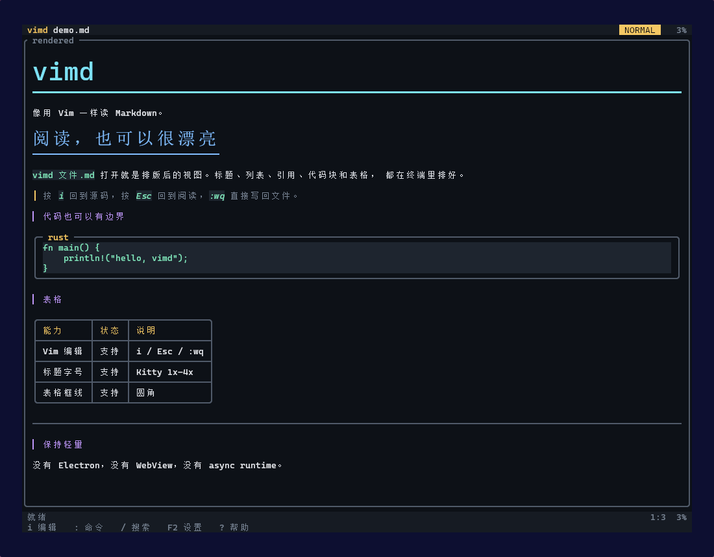
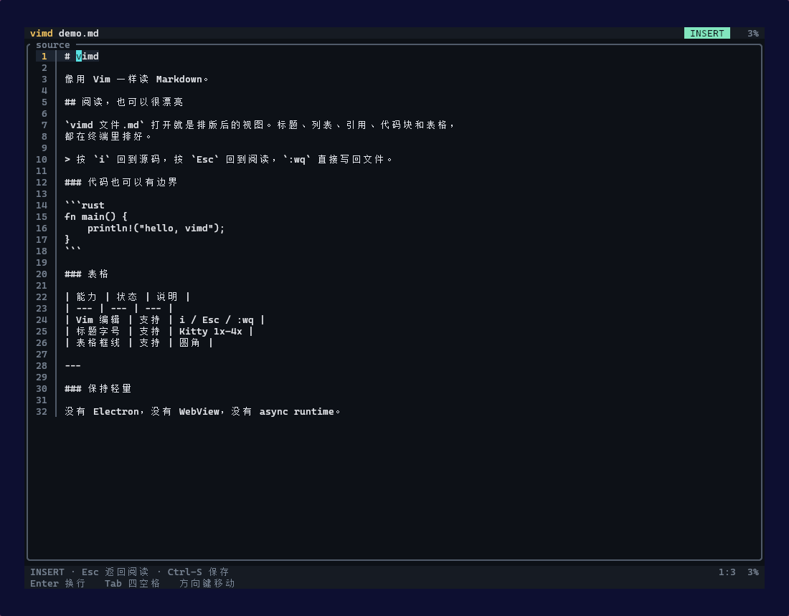
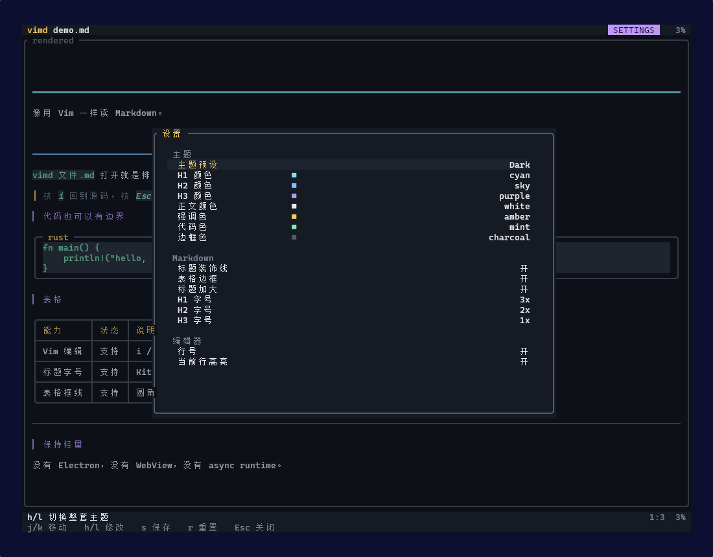

# vimd

<p align="center">
  <strong>像用 Vim 一样读 Markdown。</strong><br>
  打开就是排版好的阅读视图；按 <code>i</code> 回到源码，按 <code>Esc</code> 继续阅读。
</p>

<p align="center">
  
  
  
  
  <a href="https://github.com/AkiMinoziko/vimd/actions/workflows/ci.yml"></a>
</p>

---

## 为什么是 vimd？

像使用 vim 一样阅读和编辑 Markdown 文档！轻量高效！如果你经常在终端里工作！vimd会是很好的选择！

`vimd` 把两件事放在同一个 buffer 里：

- **阅读时**：标题、列表、引用、代码块、表格都已经排版好，没有 `#`、`**`、反引号干扰。
- **想改时**：按 `i`，立刻回到带行号的 Markdown 源码；`Esc` 回到阅读。
- **保存时**：`:wq` 就是真的写回文件，不需要预览和源文件两份状态。

它不依赖 Vim/Neovim，也不是 Electron 套壳。一个 Rust 二进制，打开即可用。

## 效果图

**阅读态：像读一份排好版的文档**



**编辑态：按 `i` 回到带行号的源码**



**设置页：主题、颜色与标题字号**



## 特点

| 关键词 | 说明 |
|---|---|
| **Vim 手感** | `i` / `a` / `o` / `Esc` / `/` / `u` / `dd` / `yy` / `p` / `:wq` |
| **阅读优先** | 隐藏 Markdown 标记，标题、引用、代码块、表格直接排好 |
| **轻量** | release 约 650 KB，3 个直接依赖，无 async runtime、无 WebView |
| **好看** | 圆角框、表头分隔、代码盒、主题色、状态栏；参考 DSH TUI 的框线风格 |
| **Kitty 大字** | OSC 66 文本缩放：H1/H2/H3 可分别设为 1x–4x |
| **可配置** | `F2` 设置页：主题、标题/正文颜色、标题字号、行号、当前行高亮 |

## 快速开始

```bash
git clone https://github.com/AkiMinoziko/vimd.git
cd vimd

cargo install --path .
vimd 文件.md
```

不想装到 Cargo bin，也可以直接构建：

```bash
cargo build --release
./target/release/vimd 文件.md
```

或者直接从 GitHub 安装：

```bash
cargo install --git https://github.com/AkiMinoziko/vimd
```

或安装到 `~/.local/bin/vimd`：

```bash
./install.sh
```

仓库不提交平台相关的预编译二进制；`install.sh` 在缺少 `bin/vimd` 时会自动
`cargo build --release`。GitHub Releases 里可以放构建好的 Linux 二进制。

## 阅读态 / 编辑态

```text
vimd notes.md          # 打开就是阅读视图
i                      # 进入源码编辑，显示行号
Esc                    # 回到阅读
:wq                    # 保存退出
```

阅读态常用按键：

| 按键 | 作用 |
|---|---|
| `j` / `k` | 上下移动 |
| `Ctrl-D` / `Ctrl-U` | 翻半页 |
| `g g` / `G` | 开头 / 结尾 |
| `i` / `a` / `I` / `A` | 进入编辑：当前位置 / 行尾 / 行首 / 行尾 |
| `o` / `O` | 下方 / 上方新开一行并编辑 |
| `:` | 命令模式，例如 `:w`、`:q`、`:wq` |
| `/` | 搜索，`n` / `N` 跳下一个 / 上一个 |
| `F2` 或 `:settings` | 设置页 |
| `?` | 快捷键帮助 |
| `u` / `Ctrl-R` | 撤销 / 重做 |
| `x` / `dd` / `yy` / `p` | 删除字符 / 删除行 / 复制行 / 粘贴行 |

编辑态就是普通输入：`Enter` 换行，`Tab` 四空格，方向键移动，`Ctrl-S` 保存，
`Esc` 回阅读。

## 设置页也可以很顺手

`F2` 打开设置页，修改会实时预览，关闭时自动保存。

## Kitty 标题字号

普通终端的字号是全局的，不能给单独某一行改大小。`vimd` 在
**Kitty 0.40+ 直连**时使用 Kitty 的
[OSC 66 文本缩放协议](https://github.com/kovidgoyal/kitty/blob/master/docs/text-sizing-protocol.rst)，
真正把标题画成多行大字：

- `H1` / `H2` / `H3` 可分别设为 `1x`–`4x`
- 默认 `H1 = 3x`、`H2 = 2x`、`H3 = 1x`
- `1x` 就是普通字号
- tmux / zellij / screen 不转发 OSC 66，会自动禁用
- 其他终端自动回退到颜色、字重、标题装饰线

在设置页里：

```text
标题加大     开
H1 字号      3x
H2 字号      2x
H3 字号      1x
```

`h/l` 调整，`s` 保存，`Esc` 关闭并自动保存。

## 设置与配置

`F2` 打开设置页：

- 主题预设：`Dark` / `Paper` / `Solarized` / `Terminal`
- H1 / H2 / H3 / 正文 / 强调 / 代码 / 边框颜色
- 标题装饰线
- 表格边框
- 标题加大总开关 + H1/H2/H3 字号
- 插入态行号
- 当前行高亮

配置保存到：

```text
$XDG_CONFIG_HOME/vimd/config.toml
# 或
~/.config/vimd/config.toml
```

示例：

```toml
preset = "dsh-dark"
h1 = "cyan"
h2 = "sky"
h3 = "purple"
body = "white"
accent = "amber"
code = "mint"
border = "charcoal"
heading_rules = true
table_borders = true
line_numbers = true
focus_line = true
text_sizing = true
h1_scale = 3
h2_scale = 2
h3_scale = 1
```

颜色默认强制开启；需要单色输出时：

```bash
vimd --no-color 文件.md
```

## Markdown 支持

- ATX 标题 `#` ~ `######`
- 粗体、斜体、删除线、行内代码
- 链接、图片 alt
- 无序 / 有序 / 嵌套列表
- 任务列表 `- [ ]` / `- [x]`
- 引用
- 围栏代码块（圆角框 + 语言标签）
- 管道表格，支持左 / 中 / 右对齐
- 水平分隔线
- HTML 注释隐藏
- YAML frontmatter 折叠，按 `i` 仍可编辑

## 已知限制

- 标题字号只在 Kitty 0.40+ 直连时可用；H4~H6 不放大。
- 表格超宽会压缩列宽并截断单元格，不做横向滚动。
- 代码块没有语言级语法高亮，只有统一的代码色。
- 图片只显示 alt 文本。
- 软换行按字符宽度断行，长英文单词可能从中间拆开。
- 不是完整 Vim：没有宏、寄存器全集、文本对象、分屏、插件系统。
- 撤销快照上限 200 步；超大文档会占一些内存。

## 开发

```bash
git clone https://github.com/AkiMinoziko/vimd.git
cd vimd
cargo build --release
cargo test
```

屏幕级验收需要 `tmux`：

```bash
./test/capture.sh
```

它会用独立的 tmux server 启动 TUI，模拟按键，检查阅读态、插入态、设置页和
`:wq`，不会碰你的真实配置。

CI 配置在 `.github/workflows/ci.yml`：格式检查、单元测试、release 构建。

## 代码结构

<details>
<summary>展开查看</summary>

```text
vimd/
├── Cargo.toml
├── Cargo.lock
├── LICENSE
├── README.md
├── CONTRIBUTING.md
├── install.sh
├── src/
│   ├── main.rs        终端初始化、事件循环、CLI
│   ├── app.rs         模式、按键、命令、设置状态
│   ├── editor.rs      文本 buffer、光标、撤销、保存
│   ├── markdown.rs    Markdown 解析、inline 样式、表格/代码盒排版
│   ├── theme.rs       色板、主题预设、配置文件
│   ├── kitty.rs       Kitty OSC 66 能力检测
│   └── ui.rs          Ratatui 界面、状态栏、弹层
├── docs/
│   ├── demo.md        README 截图用文档
│   ├── reading.png
│   ├── editing.png
│   └── settings.png
├── test/
│   ├── sample.md
│   └── capture.sh
└── .github/workflows/ci.yml
```

</details>

## License

MIT。见 [LICENSE](LICENSE)。

欢迎提 issue / PR；提交前请看 [CONTRIBUTING.md](CONTRIBUTING.md)。

> 当前版本 `0.1.0`：核心体验已经可用，配置格式和内部结构仍可能调整。
